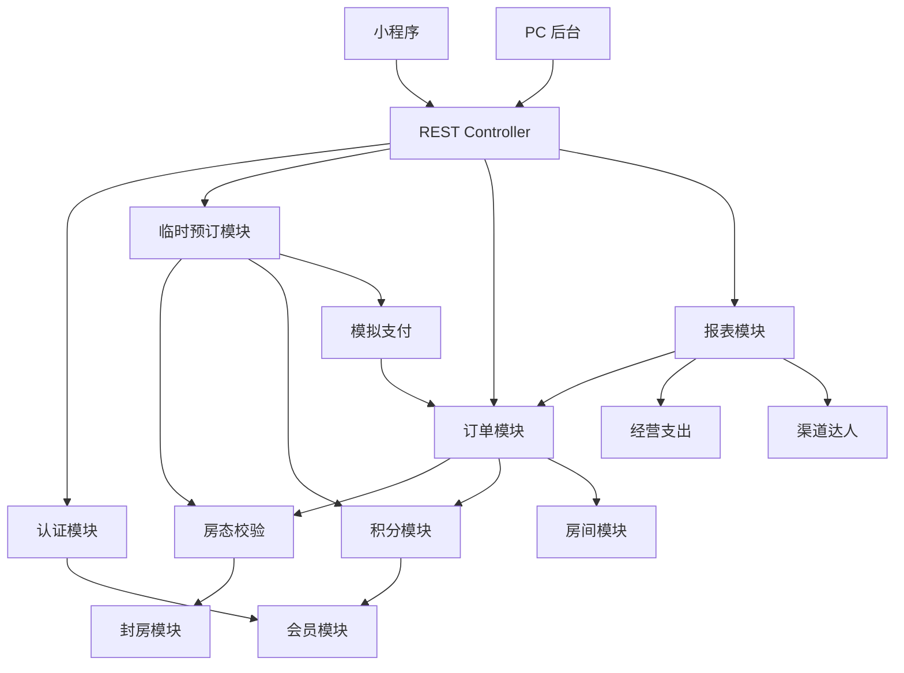

# 芊浔民宿技术架构与分阶段开发实施指南

> 版本：V1.1｜日期：2026-11-18  
> 项目：芊浔民宿（第一期）  
> **唯一业务依据**：[`需求规格说明书 V3.1`](../01-需求/芊浔民宿_需求规格说明书_V3.1_20261118.md)、[`数据库表设计文档 V3.1`](../02-数据库设计/芊浔民宿_数据库表设计文档_V3.1_20261118.md)、[`接口设计文档 V3.1`](../03-接口契约/芊浔民宿_接口设计文档_V3.1_20261118.md)。  
> 本文是**代码实施方案**，不是第四份业务需求。业务规则、字段和接口契约有争议时，以三份 V3.1 文档为准。本文提出的包名、技术库、内部类名、测试方法属于**实现建议**，并非三份文档已经规定的事实。

---

## 1. 开发目标与范围

第一期交付三部分：

1. **微信小程序**：手机号登录、首页查房、房间详情、60 天可订日历、预订填写、积分抵扣、10 分钟临时锁房、模拟支付、我的订单、自助模拟退款、会员中心和个人中心。
2. **PC 管理后台**：管理员登录、客房与封房、六房月历、七渠道订单、人工逐笔录入、订单确认/入住/退房、会员积分、渠道达人、经营支出、经营总览与四维报表。
3. **统一后端和 MySQL**：提供两端接口、并发房态校验、支付/退款/积分事务和统计查询。

明确**不做**：真实微信支付、OpenID、短信验证码、Redis、多门店、多管理员 RBAC、第三方 OTA 自动同步、周末差异价格、优惠券、通用审计日志、经营支出编辑删除、订单金额编辑、用户自助改期。

**建议开发策略**：先把后端数据库、基础业务与管理后台的“录单—房态—状态流转”做通，再接入小程序“登录—锁房—模拟支付”，最后做积分和报表。为方便开发，登录鉴权和基础查询可以先完成，但不必等整个小程序做完才开发后台。

## 2. 技术栈与工程约定

| 层次 | 推荐技术 | 用途 |
|---|---|---|
| JDK | Java 21 | 后端运行环境 |
| 后端框架 | Spring Boot 3.x | REST API、事务、依赖注入 |
| 数据访问 | MyBatis + XML | SQL 显式维护；复杂房态、统计查询易审查 |
| 数据库 | MySQL 8.0 / InnoDB | 13 张正式表及可选 `order_guest` |
| 数据迁移 | Flyway | 版本化建表、索引、初始化渠道和房间 |
| 参数校验 | Jakarta Validation | DTO 字段及日期、金额校验 |
| 安全 | Spring Security + JWT | 小程序 30 天 JWT；后台独立管理员认证 |
| 密码 | BCrypt | 管理员密码哈希 |
| API 文档 | springdoc-openapi | Swagger/OpenAPI 联调 |
| 定时任务 | Spring `@Scheduled` | 关闭过期模拟支付交易 |
| PC 前端 | Vue 3 + TypeScript + Vite + Element Plus | 管理后台 |
| 小程序 | 原生微信小程序 + TypeScript（建议） | 顾客端；如现有项目框架不同，可保持原框架 |
| 图片 | 腾讯云 COS | 房间图片文件存储，MySQL 保存 URL |
| 测试 | JUnit 5 + Spring Boot Test + Testcontainers MySQL（建议） | 集成、并发、事务测试 |
| 部署 | 单机 Docker Compose + Nginx（建议） | 后端、PC 静态页面、MySQL |

以上除 Java 21、MySQL 8、无 Redis 等已确认条件外，均为推荐落地组合；如已有前端项目，**优先沿用现有前端技术栈，不为统一而重写**。

### 2.1 统一开发规范

- API 前缀 `/api/app` 与 `/api/admin`，JSON 字段 `snake_case`；Java 属性使用 `camelCase` 并统一配置序列化映射。
- `id` 使用 `Long`；金额使用 `BigDecimal`，数据库 `DECIMAL(12,2)`，接口以字符串传递金额；禁止 `double` 计算房费。
- 日期使用 `LocalDate`；业务时间使用 `LocalDateTime`/`Instant` 并明确数据库时区；所有业务截止时间以 `Asia/Shanghai` 判断。
- 住宿区间统一为 **`[check_in, check_out)`**，不占用退房当天。
- 状态、积分类型等使用 Java `enum`；数据库存稳定字符串编码。
- Controller 只做鉴权入口、参数绑定、响应封装；业务规则写在 Service；SQL 写在 Mapper XML。
- 跨表写入使用 `@Transactional`；`@Transactional` 放在公共业务入口 Service 方法上，不依赖同类内部调用触发事务。
- 订单、积分、支付、退款使用唯一业务号及数据库唯一索引做幂等；前端禁用按钮**不能**替代后端幂等。
- 日志不要输出完整手机号、JWT、管理员密码；返回给小程序的内部金额费用和其他顾客信息按接口文档隐藏。

## 3. 推荐仓库结构

采用**单仓库、多应用、后端模块化单体**，不拆微服务：

```text
qianxun/
├── docs/
│   ├── README.md                         # 文档导航、分类和版本基线
│   ├── 01-需求/
│   │   └── 芊浔民宿_需求规格说明书_V3.1_20261118.md
│   ├── 02-数据库设计/
│   │   └── 芊浔民宿_数据库表设计文档_V3.1_20261118.md
│   ├── 03-接口契约/
│   │   └── 芊浔民宿_接口设计文档_V3.1_20261118.md
│   ├── 04-技术方案/
│   │   └── 芊浔民宿_技术架构与分阶段开发实施指南_V1.1_20261118.md
│   └── 05-视觉资料/
│       ├── 小程序/                    # 微信小程序原型、背景候选和装饰素材
│       └── 管理后台/                  # PC 管理后台原型
├── backend/
│   ├── pom.xml
│   ├── src/main/java/com/qianxun/homestay/
│   │   ├── HomestayApplication.java
│   │   ├── common/
│   │   │   ├── api/            # ApiResponse、PageResult、错误码
│   │   │   ├── exception/      # BusinessException、全局异常处理
│   │   │   ├── config/         # Jackson、MyBatis、OpenAPI、时区
│   │   │   ├── security/       # JWT、过滤器、登录上下文
│   │   │   ├── util/           # 日期、金额、编号等通用工具
│   │   │   └── enums/          # OrderStatus、PaymentStatus 等
│   │   └── modules/
│   │       ├── auth/           # 小程序/后台认证
│   │       ├── room/           # 客房、房间上下架
│   │       ├── availability/   # 日期区间占用与冲突校验
│   │       ├── roomblock/      # 管理员封房
│   │       ├── booking/        # 10 分钟临时锁房
│   │       ├── order/          # 七渠道正式订单与状态机
│   │       ├── payment/        # 模拟支付流水
│   │       ├── refund/         # 模拟退款与取消
│   │       ├── member/         # 会员资料及等级
│   │       ├── points/         # 积分预占、抵扣、奖励、流水
│   │       ├── channel/        # 七种渠道
│   │       ├── creator/        # 达人
│   │       ├── calendar/       # PC 月度房态
│   │       ├── expense/        # 经营支出
│   │       ├── report/         # 经营报表
│   ├── src/main/resources/
│   │   ├── application.yml
│   │   ├── application-dev.yml
│   │   ├── application-prod.yml
│   │   ├── mapper/            # 按模块放置 MyBatis XML
│   │   └── db/migration/      # Flyway V1__init.sql 等
│   └── src/test/java/com/qianxun/homestay/
│       ├── integration/
│       ├── concurrency/
│       └── modules/
├── frontend/admin/
│   ├── src/
│   │   ├── api/               # 各后台接口请求
│   │   ├── router/
│   │   ├── stores/
│   │   ├── layouts/
│   │   ├── views/
│   │   │   ├── login/
│   │   │   ├── dashboard/
│   │   │   ├── rooms/
│   │   │   ├── calendar/
│   │   │   ├── orders/
│   │   │   ├── members/
│   │   │   ├── points/
│   │   │   ├── channels/
│   │   │   ├── creators/
│   │   │   ├── expenses/
│   │   │   └── reports/
│   │   ├── components/
│   │   ├── types/
│   │   └── utils/
│   └── package.json
├── frontend/miniprogram/
│   ├── app.ts
│   ├── app.json
│   ├── pages/
│   │   ├── login/
│   │   ├── home/
│   │   ├── rooms/
│   │   ├── room-detail/
│   │   ├── booking/
│   │   ├── payment/
│   │   ├── booking-success/
│   │   ├── orders/
│   │   ├── order-detail/
│   │   ├── member-center/
│   │   ├── points-logs/
│   │   └── profile/
│   ├── components/
│   ├── services/              # api-client、auth、room、order 等
│   ├── utils/
│   ├── types/
│   └── assets/
├── deploy/
│   ├── docker-compose.yml
│   └── nginx.conf
└── README.md
```

> 包名 `com.qianxun.homestay` 是示例。若已有 Java 工程采用 `com.homestay.module.*`，应沿用现有包名和工程结构，按同样的**业务模块**增量落地，不要机械地整体迁移。

### 3.1 单个后端业务模块的文件结构

以 `order` 为例：

```text
modules/order/
├── controller/
│   ├── AppOrderController.java
│   └── AdminOrderController.java
├── dto/
│   ├── CreateExternalOrderRequest.java
│   ├── UpdateOrderRequest.java
│   └── OrderQuery.java
├── vo/
│   ├── OrderDetailVO.java
│   └── OrderListItemVO.java
├── entity/
│   ├── OrderEntity.java
│   └── OrderAmountEntity.java
├── mapper/
│   ├── OrderMapper.java
│   └── OrderAmountMapper.java
├── service/
│   ├── OrderService.java
│   ├── OrderCommandService.java
│   └── OrderQueryService.java
└── domain/
    ├── OrderStateMachine.java
    └── OrderNoGenerator.java

resources/mapper/order/
├── OrderMapper.xml
└── OrderAmountMapper.xml
```

**职责边界**：

- `entity`：映射表字段，不直接给前端返回。
- `dto`：请求参数与校验；`vo`：接口响应对象，避免把 `password_hash`、内部提成等意外暴露。
- `mapper`：声明数据库访问方法；SQL 写在 XML；复杂聚合查询可单独 `ReportMapper.xml`。
- `service`：事务、状态流转、金额计算、会员奖励等编排。
- `domain`：无框架依赖的核心规则，例如订单状态机、积分兑换、日期重叠判断。
- `availability`：**所有渠道共用同一套库存判断**，不能小程序和后台各写一套。

### 3.2 核心模块依赖关系



依赖图表示业务调用关系，不意味着互相注入所有 Service。跨模块操作尽量由**一个编排 Service**负责事务；避免 PaymentService ↔ OrderService ↔ PointsService 循环依赖。

---

## 4. 数据库初始化与迁移

### 4.1 第一步就完成的数据库工作

1. 新建 MySQL 数据库 `qianxun`，统一字符集、时区及开发环境账号。
2. 根据数据库 V3.1 文档逐张编写 DDL，创建 13 张正式表：`room`、`room_block`、`channels`、`creators`、`members`、`orders`、`order_amount`、`booking_lock`、`payments`、`refunds`、`points_log`、`expenses`、`admin`。
3. **可选** `order_guest` 暂不创建；确定实际入住人登记范围后再以新迁移增加。
4. 创建唯一索引、常用查询索引、外键或等效约束、金额非负 CHECK（MySQL 8 支持时）；`order_amount.net_amount` 使用文档中的生成列。
5. 初始化七种渠道、六间房和管理员账号（密码 BCrypt 哈希，禁止明文写入仓库）。
6. 在 `db/migration` 中保存迁移文件，例如：
   - `V1__create_base_tables.sql`
   - `V2__seed_channels_rooms.sql`
   - `V3__add_indexes_constraints.sql`
7. 维护 `dev` 测试数据脚本，但不要将模拟交易写入生产初始化迁移。

### 4.2 必须优先落地的数据库约束

| 表 | 约束 / 索引 | 目的 |
|---|---|---|
| `members` | `UNIQUE(phone)` | 同手机号会员不重复 |
| `room` | `UNIQUE(number)` | 六间房号唯一 |
| `orders` | `UNIQUE(order_no)` | 订单编号唯一 |
| `orders` | `UNIQUE(channel_id, platform_order_no)` | 有平台订单号时防重 |
| `orders` | `(room_id, check_in, check_out)` | 日期冲突检索 |
| `order_amount` | `UNIQUE(order_id)` | 订单金额一对一 |
| `payments` | `UNIQUE(payment_no)` | 支付幂等 |
| `refunds` | `UNIQUE(refund_no)` | 退款幂等 |
| `points_log` | `UNIQUE(ref_no)` | 奖励、抵扣、返还幂等 |
| `booking_lock` | `(room_id, check_in, check_out, status, expires_at)` | 锁房与超时查询 |

**重要**：MySQL 普通唯一索引无法保证日期区间不重叠。对同一房间的所有占用写操作，统一**先锁定 `room` 对应行 `SELECT ... FOR UPDATE`**，再查询订单、封房和有效锁房的重叠区间，最后写入；并发事务必须遵守相同锁顺序。涉及会员积分时还要锁 `members` 行，跨多行操作统一排序，减少死锁。

### 4.3 数据库 V3.1 未提供可执行 SQL

因此建表 SQL 是本阶段的**开发产物**，不能把字段设计文档直接当成已经可执行的 SQL。每张表建完要对照文档逐列核查字段、默认值、可空性、索引和生成列。

---

## 5. 总体实施阶段

建议按 **12 个阶段**推进。每阶段必须产出：代码、接口联调结果、数据库验证、测试用例与验收记录。未完成验收不进入下一阶段的大规模页面开发。

| 阶段 | 核心目标 | 主要交付 |
|---|---|---|
| 0 | 工程初始化与数据库 | 三端骨架、建表迁移、基础配置 |
| 1 | 登录与权限 | 手机号 JWT、管理员登录、统一异常 |
| 2 | 客房、渠道、达人 | 房间 CRUD、上下架、七渠道、达人管理 |
| 3 | 房态校验与封房 | 日期冲突引擎、封房、60 天日历 |
| 4 | 第三方订单与状态机 | 手工录单、金额快照、状态流转、取消 |
| 5 | 后台房态日历 | 六房月历、连住占用标记、快捷录单 |
| 6 | 小程序预订与模拟支付 | 锁房、支付、正式订单、我的订单 |
| 7 | 模拟退款 | 自助取消资格、退款流水、释放库存 |
| 8 | 会员积分完整闭环 | 等级、发放、抵扣、流水、重试 |
| 9 | 经营支出与报表 | 支出、四维月报、利润、入住率 |
| 10 | 全链路验收与部署 | 并发、权限、跨月、部署和备份运维 |

> **积分依赖提前实现**：阶段 6 的 `points_used`、冻结/预占与扣减逻辑需要阶段 8 的部分基础能力。实际编码时在阶段 6 先实现 `PointsBalanceService`、`PointsRedemptionCalculator` 和 `points_log` 写入，阶段 8 再补齐等级页面、奖励、人工发放等功能，避免支付流程写死“积分=0”。

---

## 6. 阶段 0：初始化工程、数据库和通用能力

**目标**：三端能启动，数据库迁移能执行，API 可访问。

**后端新增**：
- `HomestayApplication`、`pom.xml`、`application*.yml`
- `common/api/ApiResponse`、`PageResult`、`ErrorCode`
- `common/exception/BusinessException`、`GlobalExceptionHandler`
- `common/config/MybatisConfig`、`JacksonConfig`、`OpenApiConfig`
- `common/util/DateRangeUtils`、`MoneyUtils`
- 13 张表对应 `entity` 和最小 `mapper`，DDL 放 `resources/db/migration`

**前端新增**：PC Vue 工程与登录页占位、路由、HTTP 请求封装；小程序工程、全局请求封装、页面导航骨架。

**实现顺序**：
1. 新建 Git 仓库及三个子工程，配置 `.gitignore`。
2. 创建 MySQL 数据库并运行迁移；初始化渠道/房间。
3. 启动后端，测试健康检查（**内部辅助接口**，不计入业务接口总数）。
4. PC、小程序分别通过统一请求客户端访问测试接口。
5. 配置开发/生产环境变量或独立配置文件，敏感信息不提交 Git。

**验收**：后端启动成功、13 张表与索引正确、六间房和七渠道存在、PC/小程序可访问 API、数据库迁移可重复部署且不重复插入种子数据。

## 7. 阶段 1：登录、JWT 与管理员权限

**对应接口**：A01、A02、A03、A04。

**涉及表**：`members`、`admin`。

**后端新增**：
```text
modules/auth/controller/AppAuthController.java
modules/auth/controller/AdminAuthController.java
modules/auth/dto/PhoneLoginRequest.java
modules/auth/dto/AdminLoginRequest.java
modules/auth/vo/LoginVO.java
modules/auth/service/AuthService.java
modules/auth/service/AdminAuthService.java
common/security/JwtService.java
common/security/JwtAuthenticationFilter.java
common/security/SecurityConfig.java
modules/member/entity/MemberEntity.java
modules/member/mapper/MemberMapper.java
resources/mapper/member/MemberMapper.xml
```

**实现步骤**：
1. `A01 POST /api/app/auth/login` 校验手机号格式。
2. 按 `members.phone` 查询，存在则复用会员，不存在则插入；处理并发唯一冲突后重查。
3. 昵称统一为手机号后四位、头像统一默认地址；已存在会员首次登录覆盖旧值（实现可以对每次登录统一设置，结果一致）。
4. 签发 30 天 JWT，包含 `member_id`、角色类型、签发/过期时间；**不使用手机号作为唯一身份主键**。
5. `A02` 从 JWT 解析当前会员 ID，查询并返回个人资料。
6. `A03` 校验管理员用户名和 BCrypt 密码，签发后台管理员 Token；`A04` 返回当前管理员。
7. 安全配置区分 `/api/app/**` 和 `/api/admin/**` 权限，开放登录和无需登录的客房浏览接口；管理员不可调用会员私有数据接口，反之亦然。
8. PC 处理管理员 Token；小程序本地保存 30 天 Token，失效时跳登录页，不做刷新接口。

**前端页面**：小程序 `pages/login`；后台 `views/login`；两个端的请求拦截器和 401 处理。

**验收**：新会员自动创建、老会员不重复、并发手机号注册只一条记录、JWT 30 天、越权被拒、管理员密码不明文、用户不能修改头像/昵称。

## 8. 阶段 2：房间、渠道、达人基础资料

**对应接口**：R01、R02、R05、R06、R07、R08、R09；C01、C02；D01–D05。

**涉及表**：`room`、`channels`、`creators`。

**后端新增**：
- `modules/room/{controller,dto,vo,entity,mapper,service}`，`RoomMapper.xml`
- `modules/channel/{controller,dto,vo,entity,mapper,service}`，`ChannelMapper.xml`
- `modules/creator/{controller,dto,vo,entity,mapper,service}`，`CreatorMapper.xml`
- `RoomPriceService`：读取基础价格；创建交易时生成金额快照。

**实现步骤**：
1. 管理端房间新增、详情、编辑、上下架；房号唯一、房价非负、容量为正。
2. `facilities` 和 `images` 作为 JSON 数组存 `room`；图片存储服务本身不在三份文档中规定，可先使用已上传图片的 URL。
3. 顾客端浏览房间和详情；指定日期筛选逻辑在阶段 3 接入统一房态引擎。
4. 初始化并查询七个渠道；停用只影响新订单，不删除历史记录。
5. 达人归属一个渠道；支持新增、修改、启停，停用达人不影响历史订单。
6. 后台制作房间管理、渠道管理、达人管理列表和表单。

**验收**：六间房信息可维护，房价修改不改变已有订单/待支付交易快照；渠道与达人启停生效，历史引用不丢失。

## 9. 阶段 3：统一房态校验、封房与 60 天日历

**对应接口**：R03、R04、R10–R13；R01 的日期筛选。

**涉及表**：`room`、`room_block`、`orders`、`booking_lock`。

**后端新增**：
```text
modules/availability/service/AvailabilityService.java
modules/availability/domain/StayDateRange.java
modules/availability/mapper/AvailabilityMapper.java
modules/roomblock/controller/AdminRoomBlockController.java
modules/roomblock/service/RoomBlockService.java
modules/roomblock/mapper/RoomBlockMapper.java
resources/mapper/availability/AvailabilityMapper.xml
resources/mapper/roomblock/RoomBlockMapper.xml
```

**实现步骤**：
1. 实现日期规则：`check_in < check_out`；两个日期均在北京时间从今天开始的连续 60 个自然日内（仅小程序订房接口适用）。
2. 统一重叠判断：`existing.check_in < new.check_out AND existing.check_out > new.check_in`。
3. 查询占用来源：非取消正式订单、管理员封房、有效未过期锁房。已完成历史订单保留历史占用。
4. **封房写入**：先锁 `room` 行，再查区间冲突，最后写 `room_block`；支持调整、整段解封、通过拆分或缩短实现部分解封。
5. **可订查询**：R03 按月返回 `unavailable_dates`，只返回未来 60 天内数据；前端只渲染「可预订/不可预订」。
6. **区间复核**：R04 计算 `available`、`nights`、`room_amount`；只做预览，真正锁房仍须事务内再次检查。
7. 订单取消后无需写 `room_block`，因为房态由现有订单状态动态推导。
8. 退房日期不占用；逾期未手动退房不延长原日期占用。

**测试用例**：
- 11/20–11/22 与 11/22–11/23 不冲突；与 11/21–11/23 冲突。
- 11/20–11/22 封房期间不能下单，解封后可订。
- 已取消订单不占房；已完成历史订单在历史日期仍有记录。
- 超过 60 天日期不可在小程序预订；退房日也必须落在允许范围。
- 两个并发请求抢同一间夜，最终只能一个成功。

**验收**：小程序与后台共用房态计算，不出现同房同夜重复占用。

## 10. 阶段 4：第三方订单、金额快照和订单状态机

**对应接口**：O04、O05、O06、O07、O08、O09、O10、O12。

**涉及表**：`orders`、`order_amount`、`room`、`channels`、`creators`、`members`、`points_log`（已完成历史单的奖励先预留调用）。

**后端新增**：
```text
modules/order/controller/AdminOrderController.java
modules/order/dto/CreateExternalOrderRequest.java
modules/order/dto/UpdateOrderRequest.java
modules/order/vo/OrderDetailVO.java
modules/order/service/OrderCommandService.java
modules/order/service/OrderQueryService.java
modules/order/domain/OrderStateMachine.java
modules/order/domain/OrderNoGenerator.java
modules/order/domain/OrderAmountCalculator.java
modules/order/mapper/OrderMapper.java
modules/order/mapper/OrderAmountMapper.java
resources/mapper/order/OrderMapper.xml
resources/mapper/order/OrderAmountMapper.xml
```

**实现步骤**：
1. 统一生成 `QXYYYYMMDDNNNN` 订单号；必须并发安全，不能无锁 `MAX + 1`。
2. `O06` 只允许六个外部渠道；校验渠道启用、达人归属、日期冲突、平台订单号重复。
3. 有达人时必须输入 `expected_amount`；额外提成 `max(0, paid_amount - platform_fee - platform_commission - expected_amount)`；无达人时两项达人提成为 0。
4. 事务中写 `orders` + `order_amount`，`net_amount` 由 MySQL 生成列得出；不提供订单创建后的改价能力。
5. `O08` 待确认→待入住；`O09` 待入住→已入住且不得早于入住日；`O10` 已入住→已完成且不得早于退房日。
6. `O07` 允许所有状态编辑基本联系人信息；只有待确认/待入住允许改房间、日期，且**晚数不变**；改期时重新执行同房库存校验，排除当前订单自身。
7. `O12` 只允许待确认/待入住的**外部订单**取消；不生成本系统退款流水，保留原金额快照。
8. 已完成外部订单的自动会员奖励调用阶段 8 的 `OrderRewardService`；阶段 4 可先实现接口并用集成测试保证后续可插拔，**不要交付会漏发积分的“完整”状态流转**。
9. PC 开发订单列表、筛选、详情、手工录单、编辑、状态操作。

**验收**：七渠道统一订单模型，外部订单可录入四种初始状态；金额不可修改；正常状态不能跳级；取消外部订单释放间夜。

## 11. 阶段 5：后台六房月度房态日历

**对应接口**：K01；新增订单复用 O06。

**涉及表**：`room`、`orders`、`room_block`、`booking_lock`。

**后端新增**：
- `modules/calendar/controller/AdminCalendarController.java`
- `modules/calendar/service/CalendarQueryService.java`
- `modules/calendar/vo/CalendarDayVO.java`
- `modules/calendar/vo/CalendarRoomVO.java`
- `modules/calendar/mapper/CalendarMapper.java` + XML（如需复杂查询）

**实现步骤**：
1. 以六间房为行、日期为列生成月历。
2. 入住日显示正式状态：空房、已预订、待入住、已入住、已退房、不可预订。
3. 连住后续夜晚标记 `OCCUPIED`，只作为视觉状态，不新增数据库订单状态。
4. 续住格子与入住日格子均关联相同 `order_id`；退房当晚不占用。
5. 点击空房格子打开外部订单表单，预填房间、入住日、次日退房；提交仍调用 O06 再次校验。
6. 点击封房格子可进入封房管理；点击订单格子进入订单详情。

**验收**：跨月续住、退房当天新单入住、已完成历史订单、封房均显示正确；日历只做展示，不保存“每日房态表”。

## 12. 阶段 6：小程序预订、积分预占和模拟支付

**对应接口**：P01、P02、P08；R01–R04；O01、O02；T03 的核心计算先实现。

**涉及表**：`booking_lock`、`payments`、`orders`、`order_amount`、`members`、`points_log`、`room`。

**后端新增**：
```text
modules/booking/controller/AppBookingController.java
modules/booking/service/BookingLockService.java
modules/booking/mapper/BookingLockMapper.java
modules/payment/controller/AppPaymentController.java
modules/payment/service/MockPaymentService.java
modules/payment/service/PaymentTimeoutService.java
modules/payment/mapper/PaymentMapper.java
modules/points/service/PointsBalanceService.java
modules/points/domain/PointsRedemptionCalculator.java
modules/points/mapper/PointsLogMapper.java
resources/mapper/booking/BookingLockMapper.xml
resources/mapper/payment/PaymentMapper.xml
resources/mapper/points/PointsLogMapper.xml
```

**完整流程**：
1. 小程序用户已登录，查询房间与日期，填写预订人、手机号码、入住人数、备注。
2. 后端校验容量、入住退房日期、房价、可用积分；会员等级兑换率为普通 30、银 25、金 20、钻石 15 积分/元，单笔最多抵扣房费 20%。
3. `P01` 在事务中锁定房间和会员相关记录，检查日期与其他有效积分预占；创建 `booking_lock(PENDING)` 和 `payments(PENDING)`；`expires_at = now + 10 分钟`。
4. **积分预占不提前扣 `members.points`**：可用积分 = 当前余额 − 其他有效待支付锁房预占积分；余额计算与新锁房写入须串行。
5. 小程序支付页展示 `room_amount`、`discount_amount`、`pay_amount` 和倒计时；**点击立即支付才调用 P08**。
6. `P08` 后端按支付号锁定交易，检查归属、`PENDING`、未过期、房态仍有效；以 `booking_lock.amount` 作为支付金额，不能接收前端传来的金额。
7. 同一事务中：支付改 `SUCCESS` → 创建 `orders(PENDING_CONFIRM)` → 创建 `order_amount` → 扣减积分并写 `points_log(REDEEM, balance_after)` → 锁房改 `PAID` → 回填 `payments.order_id`。实际 SQL 顺序按外键约束调整，但必须原子提交。
8. `P02` 查询最终支付结果；前端只有收到服务端成功和正式 `order_id` 才跳转成功页。
9. 定时任务扫描超时 `PENDING` 交易，锁定支付记录确认仍未成功后标记 `CLOSED`、锁房 `EXPIRED`；释放预占。为避免事务锁顺序不一致，**所有支付成功/超时关闭操作采用相同锁定顺序**。
10. 同一支付号重复点击成功返回已有 `order_id`，不再创建新订单、不重复扣积分。
11. 小程序我的订单通过 O01/O02 只查询本人正式订单；订单卡片只展示订单号、入住日期、晚数、实付金额。

**必须验证的并发场景**：
- 两名用户同时锁同房同夜：只有一人成功。
- 一人同时发起两笔积分预占：不能超出可用积分。
- 同一支付号并发调用 P08：只有一笔正式订单和一条抵扣流水。
- 第 10 分钟支付与超时任务竞争：最终只能“成功”或“关闭”一种状态。
- 已过期锁房不能被 P08 重新支付。
- 修改房价后，仍有效的旧待支付交易使用旧快照。

**验收**：小程序从登录到模拟支付成功并自动出现在后台的全链路跑通；没有真实微信支付调用或 OpenID。

## 13. 阶段 7：自助取消与模拟退款

**对应接口**：O03、P03、P04、P05。

**涉及表**：`orders`、`payments`、`refunds`、`members`、`points_log`。

**后端新增**：
- `modules/refund/controller/AppRefundController.java`
- `modules/refund/service/MockRefundService.java`
- `modules/refund/mapper/RefundMapper.java`
- `resources/mapper/refund/RefundMapper.xml`
- `modules/order/service/OrderCancellationPolicy.java`

**实现步骤**：
1. `O03` 返回 `eligible`、`deadline` 和 `reason`，用于控制小程序取消按钮。
2. `P03` 再次验证订单归属、状态只能待确认/待入住、北京时间**严格早于入住当天 18:00**。
3. 锁定订单、支付及会员积分相关记录；只处理模拟支付成功且尚未退款的订单。
4. 生成唯一 `refund_no`，写 `refunds(SUCCESS)`，金额 = `payments.amount`，微信退款号为空。
5. 同事务将订单置 `CANCELLED`、写积分返还 `points_log(RETURN, balance_after)` 并更新会员积分。
6. 取消后房态查询自然不再把该订单计为有效占用，不需要额外删除房态记录。
7. 重复提交退款返回已成功结果，不再创建第二条成功退款、不重复返积分。
8. PC 支付和退款流水页面分别调用 P04/P05。

**验收**：入住日 17:59:59 可申请，18:00:00 不可；已入住/已完成不可取消；退款失败时整个事务回滚；退款成功后房间重新可订。

## 14. 阶段 8：会员等级、积分奖励、手动发放和会员中心

**对应接口**：M01–M05；T01–T06。**M06 是预留编号，第一期不实现编辑接口。**

**涉及表**：`members`、`points_log`、`orders`、`order_amount`。

**后端新增**：
```text
modules/member/service/MemberService.java
modules/member/service/MemberLevelService.java
modules/member/controller/AppMemberController.java
modules/member/controller/AdminMemberController.java
modules/points/controller/AppPointsController.java
modules/points/controller/AdminPointsController.java
modules/points/service/OrderRewardService.java
modules/points/service/PointsGrantService.java
modules/points/service/PointsLedgerService.java
modules/points/domain/MemberLevelCalculator.java
```

**实现步骤**：
1. 根据 `growth_points` 动态计算等级：普通 0–499、银 500–999、金 1000–1499、钻石 ≥1500；不创建等级表。
2. T01 返回规则；T02/T04 返回积分流水，必须含 `balance_after`。
3. T03 提供积分抵扣预览；支付时仍由 P01 再次计算和验证。
4. 管理员通过手机号查找或新增会员；手机号唯一；手动初始积分必须走积分流水，不允许直接改余额。
5. T05 人工发放 `HISTORY_REWARD` 同时增加 `growth_points` 和 `points`；`GIFT` 仅增加 `points`。使用 `request_no` 和 `points_log.ref_no` 防重复。
6. 小程序订单完成时，奖励给 `orders.member_id`；第三方订单完成且预订手机号有效时创建/关联会员后奖励。
7. 自动奖励积分 = `floor(order_amount.paid_amount)`；成长积分与可用积分同步增加；同一订单 `ORDER_REWARD:<order_id>` 唯一。
8. 第三方历史已完成订单手动录入时立即触发奖励；原先无手机号、完成后补手机号且未奖励时触发一次；已奖励后改手机号不转移、不重发。
9. T06 允许对符合条件且尚未奖励的订单安全重试，不引入独立任务系统。
10. 小程序独立会员中心页面展示等级、进度、余额、兑换规则和流水；个人中心展示固定昵称/头像。

**关键注意**：所有余额更新采用会员行锁并在同一事务写 `points_log.balance_after`；`balance_after` 不是客户端传入。不要把“注册手机号”与订单填写的“预订手机号”混为一谈。

**验收**：自动奖励一次、历史积分与赠送积分升级规则正确、重复请求不重复发、退款返还积分正确、会员昵称不可编辑。

## 15. 阶段 9：经营支出、总览与四维报表

**对应接口**：E01、E02、E03、E06；S01–S05。

**涉及表**：`expenses`、`orders`、`order_amount`、`room`、`room_block`、`channels`、`creators`。

**后端新增**：
```text
modules/expense/controller/AdminExpenseController.java
modules/expense/service/ExpenseService.java
modules/expense/mapper/ExpenseMapper.java
modules/report/controller/AdminDashboardController.java
modules/report/controller/AdminReportController.java
modules/report/service/ReportService.java
modules/report/service/NightAllocationService.java
modules/report/domain/MonthlyAllocationCalculator.java
modules/report/mapper/ReportMapper.java
resources/mapper/expense/ExpenseMapper.xml
resources/mapper/report/ReportMapper.xml
```

**实现步骤**：
1. E01/E02/E03/E06：支出仅新增、查询、统计；字段 `content`、`amount`、`date`；**不实现编辑/删除**。
2. 编写 `NightAllocationService`：订单金额、平台手续费、普通达人提成、额外提成按住宿晚数平均分摊；分币尾差归**最后一晚**。
3. `S02` 支持 `ALL`、`NOT_CHECKED_IN`、`CHECKED_IN`；排除取消订单。
4. 订单数只在**入住日期所属月份**计一次；间夜和金额按住宿夜晚归属月份。
5. `S03` 按七渠道、`S04` 按达人（含无主播）、`S05` 按六间房统计；复用同一分摊逻辑，禁止每个报表另写不同算法。
6. `net_amount = paid_amount - platform_fee - platform_commission - extra_commission`。
7. `operating_profit = 当月已入住订单到手金额 - 当月经营支出`，**不随报表 `scope` 改变**。
8. 房间 `room_profit` 仅扣该房订单费用，不分摊全店支出。
9. 入住率分母 = 当月总房间间夜 − 管理员封房间夜；分子只算已入住/已完成订单间夜；分母为 0 返回 `null`。
10. `S01` 今日房态和当晚住宿收入按当晚归属计算；月度汇总可切换月份。
11. PC 完成总览、四维报表、支出页面；对模拟支付收入标注为业务测试金额。

**必测跨月案例**：11/30 入住、12/02 退房，共 2 晚，实付 199.99 元，则 11 月 1 晚分摊 100.00 元，12 月 1 晚分摊 99.99 元（尾差归最后一晚）；订单数只归属 11 月。

**验收**：各维度总计与整体报表一致，跨月金额加总精确到分，净利润公式与筛选无关。

## 16. 阶段 10：全链路测试、部署和交付

### 17.1 核心测试矩阵

| 场景 | 预期 |
|---|---|
| 手机号首次登录 / 再次登录 | 同一个会员 ID；30 天 JWT |
| 小程序登录手机号与预订手机号不同 | 奖励归属下单会员 ID |
| 同房同夜并发下单 | 仅一个有效锁房/订单 |
| 前单 11/20 退房，后单 11/20 入住 | 允许 |
| 超期未入住、未退房 | 不自动改状态，不延长占用 |
| 10 分钟支付超时 | 交易关闭、释放锁房及积分预占 |
| 模拟支付重复点击 | 仅一笔订单、支付成功一次 |
| 支付与超时关闭并发 | 只有一种终态 |
| 取消时间 17:59:59 / 18:00:00 | 前者符合，其后不符合 |
| 模拟退款重复提交 | 仅一笔成功退款，积分只返一次 |
| 订单状态跳级、退房过早 | 拒绝 |
| 已完成订单取消或修改日期 | 拒绝 |
| 订单金额编辑 | 所有状态均拒绝 |
| 历史已完成第三方订单手动录入 | 有手机号时只奖励一次 |
| 会员赠送 vs 历史补发 | 成长积分变化不同 |
| 11/30–12/02 跨月订单 | 订单数仅 11 月；金额按晚分摊 |
| 管理员封房与订单冲突 | 拒绝封房或预订 |
| 普通会员冒用手机号 | 第一版方案固有风险，须记录上线限制 |

### 17.2 部署步骤（建议）

1. 准备 Linux 服务器、MySQL 持久化数据目录、后端配置与日志目录。
2. `mvn clean package` 构建后端；`npm run build` 构建 PC 前端；微信开发者工具构建小程序。
3. 通过 Docker Compose 启动 MySQL 与后端；Nginx 提供 PC 静态资源和 `/api` 反向代理。
4. 执行 Flyway 数据库迁移；核对初始化渠道与房间；创建安全管理员账号。
5. 配置 HTTPS 域名和微信小程序合法 request 域名（正式发布时按平台要求配置）。
6. 先用测试数据完成全链路验收；正式经营前清理或隔离模拟交易数据。
7. 备份数据库作为**运维措施**；这不等于第一期向管理员开放“导出/备份功能”。
8. 设置服务日志、数据库健康检查和定时任务监控；验证应用重启后超时锁房仍能关闭。

### 17.3 上线阻断条件

- **当前手机号无验证**：任何知道手机号的人都可能进入他人账号，涉及订单隐私和积分。适合作为受控开发/测试方案；对外真实运营前应增加可靠身份验证。
- **当前支付是模拟支付**：不产生真实收款；不能在公开营业环境将其当作真实已付款订单。
- **外部平台未自动同步**：必须人工及时录入，否则系统不能识别未录入订单，有跨平台超售风险。
- **无通用导出功能**：仍须有服务器层数据库备份、恢复演练和权限控制。
- 真实微信支付接入前，须另行设计 OpenID、支付回调、查单/关单、退款回调、支付幂等和测试数据迁移；**不得只把模拟支付接口替换成微信支付调用就直接上线**。

---

## 17. 代码开发检查清单（按模块）

| 模块 | Controller | Service | Mapper/XML | 页面 | 主要接口 |
|---|---|---|---|---|---|
| 认证 | AppAuth、AdminAuth | Auth、AdminAuth | Member、Admin | 两端登录 | A01–A04 |
| 客房 | AppRoom、AdminRoom | Room | Room | 房间列表/详情/管理 | R01、R02、R05–R09 |
| 可订/封房 | AppAvailability、AdminRoomBlock | Availability、RoomBlock | Availability、RoomBlock | 预订日历/封房管理 | R03、R04、R10–R13 |
| 订单 | AppOrder、AdminOrder | OrderCommand、OrderQuery | Order、OrderAmount | 我的订单/后台订单 | O01–O10、O12 |
| 支付 | AppPayment、AdminPayment | BookingLock、MockPayment、Timeout | BookingLock、Payment | 预订填写/支付/结果 | P01、P02、P04、P08 |
| 退款 | AppRefund、AdminRefund | MockRefund | Refund | 取消确认/退款流水 | O03、P03、P05 |
| 会员 | AppMember、AdminMember | Member、MemberLevel | Member | 会员中心/会员管理 | M01–M05 |
| 积分 | AppPoints、AdminPoints | PointsLedger、Reward、Grant | PointsLog、Member | 积分流水/手动发放 | T01–T06 |
| 渠道/达人 | AdminChannel、AdminCreator | Channel、Creator | Channel、Creator | 渠道/达人管理 | C01–C02、D01–D05 |
| 日历 | AdminCalendar | CalendarQuery | Calendar | 六房月历 | K01 |
| 支出 | AdminExpense | Expense | Expense | 支出列表/新增 | E01–E03、E06 |
| 报表 | AdminDashboard、AdminReport | Report、NightAllocation | Report | 总览/四维报表 | S01–S05 |

> **注意接口编号不是连续实现数量**：M06 是预留不实现；P06/P07 真实微信回调不实现；E04/E05 支出编辑删除不实现。不要为了“补齐编号”创建空接口。

## 19. 推荐每个阶段的 Codex 执行方式

每次只给 Codex **一个阶段**，避免一次性生成全部模块导致接口、数据库和业务规则不一致。

**通用执行提示词模板**：

```text
你正在开发“芊浔民宿”第一期。
先从 `docs/README.md` 文档中心确认当前版本，并阅读以下四份文档：
1. `docs/01-需求/芊浔民宿_需求规格说明书_V3.1_20261118.md`
2. `docs/02-数据库设计/芊浔民宿_数据库表设计文档_V3.1_20261118.md`
3. `docs/03-接口契约/芊浔民宿_接口设计文档_V3.1_20261118.md`
4. `docs/04-技术方案/芊浔民宿_技术架构与分阶段开发实施指南_V1.1_20261118.md`

当前只实施【阶段 X：阶段名称】，不要提前开发其他阶段。
先检查现有代码、数据库迁移和目录结构，列出：
- 现有可复用代码；
- 本阶段涉及的接口编号、请求响应、数据库表；
- 需要新增或修改的文件清单；
- 本阶段风险与测试场景。

然后实施代码。后端采用 Java 21 + Spring Boot + MyBatis XML + MySQL 8；
不使用 Redis，不接入真实微信支付、OpenID、短信验证码。
保留现有项目的包名和代码风格，禁止无必要重构。

实现要求：
1. 严格按 V3.1 接口路径、snake_case JSON、状态和金额规则实现。
2. Controller 不写复杂业务；Service 处理事务和规则；SQL 放 Mapper XML。
3. 对日期重叠、支付、退款、积分使用数据库事务、行锁和幂等约束。
4. 必须添加对应单元/集成测试，尤其是失败回滚和并发场景。
5. 不自行新增数据库字段或未确认的业务功能。
6. 完成后给出：修改文件清单、接口清单、数据库变更、测试命令及结果、
   已知限制，以及下一阶段的依赖项。
```

**每个阶段的完成标准**：不仅能启动，还要有接口请求样例、测试通过记录、数据表前后变化验证和错误场景验证。

## 20. 三份 V3.1 文档的实施边界与已发现需注意之处

1. **接口总览计数是规划口径**：接口设计文档总览写“62”，但部分编号为预留或缺号。实施时应以**各模块实际列出的路径**为准，不应机械创建 62 个 Controller 方法。
2. **V3.1 中 `order_amount.paid_amount` 的文字仍有“微信实付”字样**：第一期按同文档支付章节的最终约定解释为**模拟实付金额**，不接微信支付。
3. **V3.1 需求文档的“支付前冻结积分”**，数据库与接口文档进一步定义为通过有效 `booking_lock.points_used` **逻辑预占**，不是提前减少 `members.points`。
4. **月度房态 `OCCUPIED`** 是接口展示标记，不是 `orders.status` 的正式枚举值。
5. **小程序 60 天限制**适用于小程序可订/预订，后台历史订单录入不能机械套用该限制。
6. **后台“经营支出只增查统”**，不应因历史讨论而额外实现修改/删除。
7. **订单实际入住人登记**在 V3.1 是可选的 `order_guest`，尚无正式接口编号。未经确认不擅自新增独立入住人接口；如实际业务必须登记，再补充数据库和接口设计。
8. **订单编号日流水分配**的具体实现未固定：可采用独立数据库序列方案或事务锁方案；若要新增序列表，应先同步更新数据库设计文档，不能偷偷增加第 14 张正式表。
9. **手动录单无平台订单号**时由管理员核对重复，系统仍须执行有效订单日期冲突校验。
10. **真实微信支付不属于第一期**；用户明确要求不增加 `pay_type`，因此本文也不新增此字段。

---

## 21. 推荐第一周最小开发目标

如果从空仓库开始，优先完成一个可验证的小闭环：

1. 数据库 13 张表、六间房和七渠道初始化。
2. 后端统一响应、异常、JWT 鉴权。
3. 小程序手机号登录 + PC 管理员登录。
4. 房间列表、房间详情、后台修改房价。
5. 日期冲突查询与管理员封房。
6. 后台手工录入一笔第三方订单并显示在房态日历。

**第一周不急于做经营报表、积分完整页面或真实支付。** 先验证“日期、订单、金额快照”这三项基础能力，再扩展小程序模拟支付与积分闭环。

> **最终交付原则**：每个阶段完成后，对照三份 V3.1 文档逐条核对；三端一致、数据库一致、接口一致、状态与金额一致，才算真正完成。


## 18. V1.1 / V3.1 实施补充

### 17.1 第一阶段范围冻结

- 仅管理员逐笔录入第三方订单，会员仅单独创建；不开发订单/会员 CSV、Excel 批量导入及 `importdata` 模块。
- 不开发用户画像、画像字段或画像接口。
- 10 分钟临时锁房只在小程序预支付阶段生效；后台月历不展示该状态，但创建订单、封房必须事务内校验有效锁房。
- 积分为整数；人民币抵扣金额采用 `BigDecimal` 向下取整到分，不得使用 `double`；抵扣上限为房费 20%。
- 历史第三方订单由管理员处理冲突，后端必须拒绝有效占房区间重叠，不提供强制忽略冲突选项。

### 17.2 旧库房间数据迁移（独立一次性任务）

1. 只读连接本地 `homestay_db`，备份后检查 `room` 与 `room_type` 的记录及外键关联。数据库密码只在本地私密配置中保存，**不得写入文档、代码仓库或日志**。
2. 按 `room.room_type_id = room_type.id` 联表，映射到新库单表 `room`：房号、名称、楼层、基础价、人数、床型、面积、设施、图片、描述及启用状态。
3. 旧 `weekend_price`、`holiday_price`、`status`、`clean_status` 不映射为新价格或新房态；设施和图片 TEXT 的真实序列化格式必须先取样核对。
4. 图片文件采用腾讯云 COS；先核实旧图片 URL 的可访问性与存储位置，按需上传到 COS，再将新 URL 数组写入 `room.images`。
5. 迁移脚本支持 dry-run、记录新旧房号映射、可重复执行且不重复创建；迁移后核对 101、102、103、201、202、203 六间房，原库不覆盖。

### 17.3 交付边界

当前接口文档不包含 COS 上传接口；如果后台需要直接上传图片，应在实现时单独设计受保护的临时上传凭证或服务端上传接口，并同步接口契约。第一阶段仍是模拟支付内部测试版本，不能直接用于真实收款或无验证手机号的公开运营。
